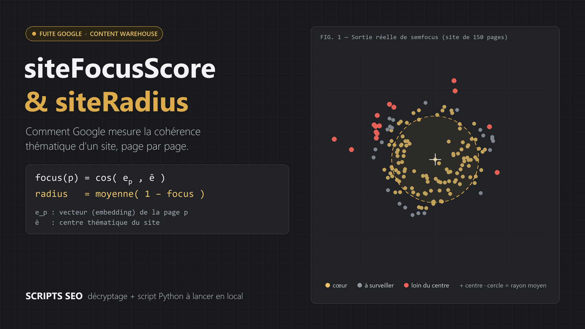

# semfocus

Measure the semantic focus of a website, in the spirit of `siteFocusScore` and `siteRadius`, two attributes revealed by
the Google Content Warehouse leak (2024). Type an address: semfocus reads the site, turns every page into a vector
(embedding) and tells you which pages sit at the heart of the site, which ones drift away from it, and which pairs are
too close to each other.

Everything runs locally and for free: no API key, no account.



## What it does

1. **Collects the pages** from the sitemap (index and `.gz` included, evenly sampled on large sites), or by following
   internal links when there is no sitemap. Skipped: pages in `noindex` (meta tag or `X-Robots-Tag` header), pages
   whose canonical points to another address, and archive pages (WordPress categories, tags, authors, pagination,
   feeds, search), which are lists of excerpts that always land near the centre. Rate limits (429, 503) are respected.
2. **Keeps the main content**: `<main>` or `<article>` when present, without menus, headers, footers, scripts, blocks
   made mostly of links, short fragments (dates, counters, buttons) and blocks repeated on more than 30 % of the pages.
3. **Embeds every page** with a free multilingual model that runs on your machine (`intfloat/multilingual-e5-base`).
   The model reads 512 tokens at most, so long pages are split into passages of about 300 words (up to 12, about
   3,600 words) and the page vector is the length-weighted mean of its passages.
4. **Computes the centre** of the site (one centre per language on multilingual sites) and, for every page,
   `focus = cos(page, centre)`. The radius is `mean(1 - focus)`. With `--core`, the centre is the mean of the pages
   you choose (home, product pages...) instead of the mean of the whole site, which outliers would pull towards them.
5. **Flags the outliers** with a robust deviation from the median, in MADs (median absolute deviation): a page is
   "far from the centre" only if it really drops out (default: 2.5 MADs below the median), so a well-focused site
   gets no false alarm. The deviation is computed language by language. On template-driven sites, where pages are
   nearly identical and the spread is tiny, a floor applies: a page is flagged only if it sits at least 1.5 times
   further from the centre than the median page.
   Utility pages (contact, legal notice, privacy policy, about...) are off-topic by nature: they are listed apart,
   and weigh neither on the centre nor on the threshold.
6. **Reads the internal linking**: links placed in the content (not in menus, headers or footers) from one analysed
   page to another. For every page, the number of inbound and outbound links; for every close pair, whether the two
   pages link to each other.
7. **Reports**, in French:
   - the core of the site and the pages that drop out;
   - the closest pairs of pages (duplicates or cannibalisation to check), always within the same language, and
     whether they link to each other;
   - the pages that receive no link from the content of another page;
   - `semfocus-<site>.csv`: every page with its score, verdict, links and closest page (opens in Excel);
   - `semfocus-<site>.svg`: a map of the pages, to open in a browser (hover a point to see the page).

## Getting started

Python 3.9 or later.

```bash
pip install -r requirements.txt
python semfocus.py https://example.com
```

The first run downloads the model (about 1.1 GB); PyTorch, installed by `pip`, weighs about 1 GB. Then everything runs
offline. About three minutes for 400 pages on a regular computer, without a GPU.

Downloaded pages (kept 24 hours) and vectors are cached in `.semfocus-cache/`, in the current folder: running again
with another threshold, `--core` or `--exclude` downloads and computes nothing twice. Delete the folder to start over.

Options:

```bash
python semfocus.py https://example.com --max 500                                  # pages analysed (default 300)
python semfocus.py https://example.com --model intfloat/multilingual-e5-small     # faster, less accurate
python semfocus.py https://example.com --utility "/(contact|legal|privacy)/?$"    # replaces the default utility pages ("" treats them like the others)
python semfocus.py https://example.com --refresh                                  # download the pages again, ignoring the cache
python semfocus.py https://example.com --cache-hours 72                           # keep cached pages longer (default 24)
python semfocus.py https://example.com --core "^/$|^/products/"                   # pages that define the centre (regex on the path)
python semfocus.py https://example.com --exclude "/category/|/tag/|/shop/"         # replaces the default archive filter ("" keeps everything)
python semfocus.py https://example.com --z 2                                      # stricter outlier threshold (default 2.5)
```

## Reading the results

- **Far from the centre, no traffic**: remove, stop linking to it, or `noindex`.
- **Far from the centre, with traffic**: tie it back to the core through internal links and context.
- **Close to the centre but ranking poorly**: reinforce its content and internal links.
- **Pairs too close**: merge with a 301, or make the two pages really different. Two close pages that link to each
  other are more likely a series than a duplicate.
- **No inbound link, close to the centre**: a page worth linking from the related articles.

## Limits

- The leak gives the names of the attributes, not their weight in ranking. This is a diagnostic, not a ranking formula.
- Scores depend on the model: compare pages of the same site with each other, not with an absolute threshold.
- A page flagged "far from the centre" is a page to look at, not a page to delete: check its traffic first.
- On the map, the distance to the centre comes from the score (scaled from the most central page to the furthest);
  only the angle is an approximation (principal component analysis).
- JavaScript is not run: content injected by scripts is not seen.
- Internal links are counted between analysed pages only: links from menus, footers and excluded archive pages
  (categories, pagination) are left out, and the count is partial when the sitemap is sampled (`--max`).

## License

[MIT](LICENSE)
